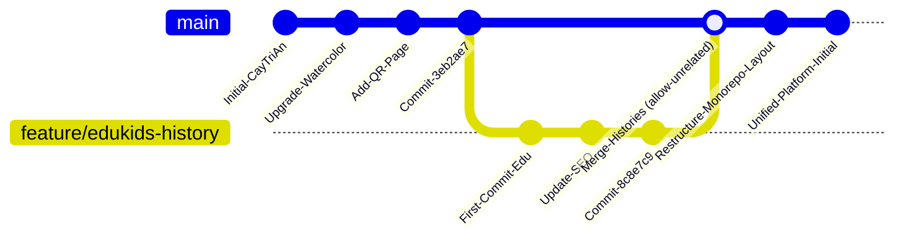

# KẾ HOẠCH DI CHUYỂN MÃ NGUỒN VÀ HỢP NHẤT REPOSITORY
## MONOREPO MIGRATION & HISTORICAL INTEGRATION PLAN

> **Tài liệu:** Kế hoạch Chi tiết Di chuyển Mã nguồn và Bảo tồn Lịch sử Phát triển  
> **Phiên bản:** 1.0.0-PROPOSAL (Design & Preparation Phase)  
> **Ngày lập:** 17/11/2026  
> **Trạng thái:** DỰ THẢO THIẾT KẾ – CHỜ PHÊ DUYỆT (Quy tắc cấm sửa đổi code vẫn đang có hiệu lực)  
> **Áp dụng cho:**  
> - Dự án A: `E:\edukids-team` (Remote: `https://github.com/tomnyson/edukids-team.git`, Branch: `main`, Commit: `8c8e7c9`)  
> - Dự án B: `E:\cay-tri-an-tay-nguyen` (Remote: `https://github.com/tetsuya47/cay-tri-an-tay-nguyen.git`, Branch: `main`, Commit: `3eb2ae7`)

---

## 1. MỤC TIÊU VÀ NGUYÊN TẮC BẤT DI BẤT DỊCH (NON-NEGOTIABLES)

1. **Bảo tồn toàn vẹn Git History (100% History Retention):**
   * Sử dụng kỹ thuật Git Multi-Remote Merge (hợp nhất các cây lịch sử không liên quan - `allow-unrelated-histories`) hoặc `git subtree` để giữ lại từng commit, commit message, thời gian và tác giả của cả hai dự án gốc.
2. **Bảo vệ tuyệt đối cấu hình và bản sao lưu hiện có:**
   * Không xóa hoặc ghi đè bất kỳ file backup nào hiện hữu (như `app.js.bak`, `index.html.bak`, `qr.js.bak`, `style.css.bak`, `FINAL_MSAIP.zip`, v.v.).
   * Tất cả file cấu hình gốc (`config.js`, `supabase.sql`, `electron-builder.yml`, `electron.vite.config.ts`) phải được lưu trữ nguyên vẹn ở vị trí đích tương ứng.
3. **Giải quyết triệt để xung đột file trùng tên (Collision Resolution):**
   * Phân giải có hệ thống các file trùng tên ở thư mục gốc: `package.json`, `README.md`, `.gitignore`, `.editorconfig`, `tsconfig.json`.
4. **Quy trình Rollback tức thì (Instant Rollback Plan):**
   * Mỗi giai đoạn đều có mốc kiểm soát (Checkpoints) và lệnh đảo ngược tức thì nếu xảy ra sự cố ngoài dự kiến.
5. **Khả năng độc lập phát triển (Bi-directional Independence):**
   * Sau khi hợp nhất, lập trình viên vẫn có thể chạy web Cây Tri Ân độc lập chỉ với Live Server / python http.server, đồng thời có thể chạy riêng Desktop Claude GUI mà không bắt buộc phải build toàn bộ monorepo.

---

## 2. CHIẾN LƯỢC SAO LƯU DỰ PHÒNG (BACKUP STRATEGY)

Trước khi thực hiện bất kỳ lệnh Git nào làm biến đổi cấu trúc, phải tạo bản sao lưu vật lý độc lập 100% ra khỏi phạm vi làm việc của Git.

### 2.1. Ma trận sao lưu (Backup Matrix)

| Mục tiêu sao lưu | Phương pháp sao lưu | Vị trí lưu trữ | Tên tệp tin / Thư mục sao lưu |
| :--- | :--- | :--- | :--- |
| `E:\cay-tri-an-tay-nguyen` | Zip Archive nguyên trạng (Full) | `E:\_BACKUPS_PRE_MIGRATION\` | `cay-tri-an-tay-nguyen-backup-20261117-commit3eb2ae7.zip` |
| `E:\edukids-team` | Zip Archive nguyên trạng (Full) | `E:\_BACKUPS_PRE_MIGRATION\` | `edukids-team-backup-20261117-commit8c8e7c9.zip` |
| Git Bundle Dự án A | Git Native Bundle (Lưu mọi branch, tag) | `E:\_BACKUPS_PRE_MIGRATION\` | `edukids-team-all-refs.bundle` |
| Git Bundle Dự án B | Git Native Bundle (Lưu mọi branch, tag) | `E:\_BACKUPS_PRE_MIGRATION\` | `cay-tri-an-all-refs.bundle` |

### 2.2. Lệnh thực hiện sao lưu dự kiến (Thực hiện khi được phê duyệt)
```powershell
# Tạo thư mục sao lưu độc lập
New-Item -ItemType Directory -Path "E:\_BACKUPS_PRE_MIGRATION" -Force

# Tạo Git Bundle bảo tồn toàn bộ ref và commit history
git -C "E:\cay-tri-an-tay-nguyen" bundle create "E:\_BACKUPS_PRE_MIGRATION\cay-tri-an-all-refs.bundle" --all
git -C "E:\edukids-team" bundle create "E:\_BACKUPS_PRE_MIGRATION\edukids-team-all-refs.bundle" --all

# Nén zip toàn bộ thư mục (bao gồm cả .git)
Compress-Archive -Path "E:\cay-tri-an-tay-nguyen" -DestinationPath "E:\_BACKUPS_PRE_MIGRATION\cay-tri-an-tay-nguyen-backup-20261117.zip" -CompressionLevel Optimal
Compress-Archive -Path "E:\edukids-team" -DestinationPath "E:\_BACKUPS_PRE_MIGRATION\edukids-team-backup-20261117.zip" -CompressionLevel Optimal
```

---

## 3. PHƯƠNG ÁN HỢP NHẤT LỊCH SỬ GIT (GIT HISTORY CONSOLIDATION)

Để kết hợp hai repository thành một Monorepo duy nhất mà **không làm mất một commit nào**, chúng ta áp dụng phương pháp **"Pre-Move Multi-Branch Merge"**:



### 3.1. Các bước hợp nhất Git chuẩn xác:
1. **Khởi tạo Repo Đích (Target Unified Repository):**
   * Tạo thư mục dự án mới: `E:\cay-tri-an-tay-nguyen-platform`.
   * Khởi tạo `git init`.
2. **Kéo lịch sử từ Cây Tri Ân (`cay-tri-an-tay-nguyen`):**
   * Thêm remote cục bộ: `git remote add source-gratitude "E:\cay-tri-an-tay-nguyen"`.
   * Fetch toàn bộ: `git fetch source-gratitude`.
   * Tạo branch tạm: `git checkout -b gratitude-base source-gratitude/main`.
   * Di chuyển toàn bộ file của Cây Tri Ân vào thư mục `apps/gratitude-web/` bằng lệnh `git mv` (để Git ghi nhận file rename và giữ lịch sử theo dõi qua `git log --follow`).
   * Commit bước tái cấu trúc: `git commit -m "refactor: restructure gratitude web into apps/gratitude-web"`.
3. **Kéo lịch sử từ Claude GUI (`edukids-team`):**
   * Thêm remote cục bộ: `git remote add source-claudegui "E:\edukids-team"`.
   * Fetch toàn bộ: `git fetch source-claudegui`.
   * Tạo branch tạm: `git checkout -b claudegui-base source-claudegui/main`.
   * Phân bổ file của Claude GUI vào cấu trúc Monorepo mới (`apps/platform-desktop/`, `packages/`, `services/`, `tests/`) bằng `git mv`.
   * Commit bước tái cấu trúc: `git commit -m "refactor: restructure claude-gui into monorepo packages"`.
4. **Hợp nhất hai luồng lịch sử vào nhánh `main`:**
   * Trở lại nhánh chính: `git checkout -b main gratitude-base`.
   * Tiến hành Merge nhánh `claudegui-base` với cờ đặc biệt:
     ```bash
     git merge claudegui-base --allow-unrelated-histories -m "chore: merge Cay Tri An and Claude GUI repositories into unified platform"
     ```
   * Vì các file đã được phân định vào các thư mục con riêng biệt (`apps/gratitude-web/` và các package còn lại) trước khi merge, lệnh merge sẽ hoàn tất trơn tru với **Zero Conflict**!

---

## 4. BẢNG PHÂN GIẢI XUNG ĐỘT FILE TRÙNG TÊN (COLLISION RESOLUTION TABLE)

Khi hai dự án đặt cạnh nhau ở cấp độ Monorepo, có một số file cùng tên. Bảng sau chỉ rõ quy tắc xử lý:

| Tên file trùng | Vị trí ở Cây Tri Ân | Vị trí ở Claude GUI | Cách phân giải trong Monorepo thống nhất |
| :--- | :--- | :--- | :--- |
| `package.json` | *Không có* (Web tĩnh thuần) | Gốc `E:\edukids-team` | - **Root `package.json`**: Tạo mới để khai báo workspaces (`apps/*`, `packages/*`, `services/*`).<br>- **Desktop `package.json`**: Chuyển `package.json` của Claude GUI vào `apps/platform-desktop/package.json` và cập nhật dependency path. |
| `README.md` | Giới thiệu Báo tường Cây Tri Ân | Giới thiệu Claude GUI Desktop | - **Root `README.md`**: Viết mới, giới thiệu toàn diện **CÂY TRI ÂN TÂY NGUYÊN PLATFORM**.<br>- Lưu tài liệu gốc vào: `apps/gratitude-web/README.md` và `apps/platform-desktop/README.md`. |
| `.gitignore` | Bỏ qua `.env`, backup files | Bỏ qua `node_modules`, `out`, `dist` | - **Root `.gitignore`**: Hợp nhất danh sách bỏ qua (node_modules, out, dist, .env, *.bak, *.exe, v.v.).<br>- Giữ thêm `.gitignore` cục bộ trong từng app nếu có quy tắc đặc thù. |
| `tsconfig.json` | *Không có* | Gốc `E:\edukids-team` | - Tạo `tsconfig.base.json` ở root chứa quy tắc chung (Strict type-checking, ES2022).<br>- `apps/platform-desktop` và các `packages/*` kế thừa từ `tsconfig.base.json` qua thuộc tính `"extends"`. |
| `eslint.config.mjs` | *Không có* | Gốc `E:\edukids-team` | Đưa lên thư mục gốc Monorepo để kiểm tra chất lượng mã nguồn cho toàn bộ các packages và apps (bao gồm cả mã JavaScript của Cây Tri Ân). |
| `.editorconfig` | *Không có* | Gốc `E:\edukids-team` | Đưa lên thư mục gốc Monorepo để thống nhất định dạng thụt lề, UTF-8 và kết thúc dòng trên Windows (CRLF/LF). |
| `.vscode/` | *Không có* | Có settings & recommendations | Đưa lên root `.vscode/` và bổ sung cấu hình Workspace đa thư mục tiện lợi cho lập trình viên. |

---

## 5. THIẾT LẬP WORKSPACES & QUẢN LÝ DEPENDENCY (PNPM WORKSPACES)

Khuyến nghị sử dụng **pnpm** (nhờ khả năng chia sẻ gói tin tiết kiệm dung lượng đĩa cứng trên ổ `E:\` và cơ chế symlink độc lập, an toàn hơn npm/yarn):

### 5.1. File `pnpm-workspace.yaml` tại thư mục gốc
```yaml
packages:
  - 'apps/*'
  - 'packages/*'
  - 'services/*'
```

### 5.2. File `package.json` tại thư mục gốc Monorepo
```json
{
  "name": "cay-tri-an-tay-nguyen-platform",
  "version": "1.0.0",
  "private": true,
  "description": "Unified Platform combining Gratitude Space and AI Innovation Space",
  "scripts": {
    "dev:web": "pnpm --filter gratitude-web dev",
    "dev:desktop": "pnpm --filter platform-desktop dev",
    "dev": "pnpm dev:desktop",
    "build:web": "pnpm --filter gratitude-web build",
    "build:desktop": "pnpm --filter platform-desktop build",
    "build:win": "pnpm --filter platform-desktop build:win",
    "build": "pnpm --filter \"./packages/*\" build && pnpm --filter platform-desktop build",
    "typecheck": "pnpm --recursive typecheck",
    "lint": "eslint --cache .",
    "format": "prettier --write .",
    "test:unit": "pnpm --filter claude-gui-core test",
    "test:smoke": "pnpm --filter platform-desktop smoke",
    "test:all": "pnpm test:unit && pnpm test:smoke"
  },
  "devDependencies": {
    "eslint": "^9.39.1",
    "prettier": "^3.7.4",
    "typescript": "^5.9.3"
  }
}
```

---

## 6. KỊCH BẢN THỰC THI DI CHUYỂN TỪNG BƯỚC (STEP-BY-STEP EXECUTION)

```
+-----------------------------------------------------------------------------------------+
|                               QUY TRÌNH MIGRATION 6 BƯỚC                                 |
+-----------------------------------------------------------------------------------------+
| [ BƯỚC 1: BACKUP & KIỂM TRA CHẶT CHẼ ]                                                 |
| -> Tạo Zip Archive + Git Bundle vào E:\_BACKUPS_PRE_MIGRATION                           |
|                                                                                         |
| [ BƯỚC 2: KHỞI TẠO REPO HỢP NHẤT & CHUYỂN DỜI CÂY LỊCH SỬ ]                            |
| -> Tạo E:\cay-tri-an-tay-nguyen-platform                                                |
| -> Kéo Git history của cả 2 dự án, phân luồng bằng git mv & merge allow-unrelated       |
|                                                                                         |
| [ BƯỚC 3: PHÂN BỔ MODULES VÀ TÁCH CORE ]                                                |
| -> Tách src/main/orchestrator, runner, queue, providers thành packages chuyên trách     |
|                                                                                         |
| [ BƯỚC 4: LIÊN KẾT DEPENDENCY & WORKSPACE ]                                             |
| -> Cấu hình pnpm-workspace.yaml & liên kết "workspace:*"                               |
|                                                                                         |
| [ BƯỚC 5: XÁC THỰC BUILD & KIỂM THỬ ]                                                   |
| -> Chạy linter, typecheck, 37 bài unit tests, smoke test trên Windows                   |
|                                                                                         |
| [ BƯỚC 6: BÀN GIAO & KHỞI CHẠY KHÔNG GIAN HỢP NHẤT ]                                    |
| -> Xác nhận Web chạy độc lập và Desktop Cockpit hoạt động đa không gian                |
+-----------------------------------------------------------------------------------------+
```

### Bước 1: Chuẩn bị & Đóng băng môi trường (Freeze & Pre-flight Check)
* Kiểm tra `git status` tại cả 2 dự án (bảo đảm mọi thay đổi chưa commit đã được kiểm kê).
* Sao lưu toàn bộ sang `E:\_BACKUPS_PRE_MIGRATION`.
* Khóa trạng thái database Supabase (không chạy lệnh DDL mới trong quá trình chuyển đổi).

### Bước 2: Tạo Repo Hợp nhất và Tích hợp Git History
* Thực hiện tuần tự các lệnh Git đã định nghĩa ở Mục 3.
* Kiểm tra lịch sử bằng `git log --graph --oneline` để xác nhận cả commit `3eb2ae7` của Cây Tri Ân và `8c8e7c9` của Claude GUI đều xuất hiện trên đồ thị Git.

### Bước 3: Phân bổ mã nguồn và Tách Core Packages
* Tạo các thư mục package tương ứng.
* Chuyển mã nguồn:
  * `apps/gratitude-web`: Chứa toàn bộ tệp của `cay-tri-an-tay-nguyen`.
  * `packages/claude-gui-core`: Chứa logic non-UI từ `edukids-team/src/main/` (orchestrator, queue, search, runner).
  * `services/ai-gateway`: Chứa các AI Adapters từ `src/main/providers/`.
  * `packages/ai-studio`: Chứa các component React từ `src/renderer/`.
  * `apps/platform-desktop`: Chứa Electron main wrapper, preload, và unified shell app.

### Bước 4: Khởi tạo liên kết Workspace
* Cài đặt dependency thông qua pnpm:
  ```powershell
  cd "E:\cay-tri-an-tay-nguyen-platform"
  pnpm install
  ```
* Kiểm tra việc liên kết symlink giữa các package nội bộ.

### Bước 5: Chạy quy trình Kiểm thử và Đánh giá (Verification Matrix)
* Chạy Typecheck: `pnpm typecheck` (phải đạt 0 lỗi).
* Chạy Linter: `pnpm lint` (phải đạt 0 lỗi).
* Chạy Unit tests: `pnpm test:unit` (toàn bộ 37 bài test phải Passed).
* Chạy Desktop Smoke test: `pnpm test:smoke` (xác nhận Electron khởi động và IPC liên kết trơn tru).

### Bước 6: Nghiệm thu và Cấu hình Remote Git mới
* Thiết lập remote chính thức cho repository hợp nhất:
  * `git remote add origin <unified-repo-url>`
* Tạo tag phát hành đầu tiên: `git tag -a v1.0.0-unified -m "Release: Cay Tri An Tay Nguyen Platform v1.0.0"`.

---

## 7. KẾ HOẠCH ROLLBACK CHI TIẾT (DISASTER RECOVERY & ROLLBACK PLAN)

Trong trường hợp xảy ra sự cố kỹ thuật nghiêm trọng tại bất kỳ bước nào, quy trình rollback lập tức được kích hoạt để đưa mọi thứ trở lại trạng thái ban đầu trong vòng dưới 2 phút.

### 7.1. Bảng kịch bản Rollback

| Điểm xảy ra sự cố | Hiện tượng phát hiện | Quy trình Rollback tương ứng |
| :--- | :--- | :--- |
| **Giai đoạn Git Merge** | Xung đột file hoặc lỗi Git graph không mong muốn | - Hủy merge ngay lập tức: `git merge --abort`.<br>- Xóa thư mục thử nghiệm `E:\cay-tri-an-tay-nguyen-platform`.<br>- Không có tác động nào tới hai repo gốc vì toàn bộ thao tác diễn ra trên repo mới. |
| **Giai đoạn Tách Module** | Lỗi circular dependency hoặc import không phân giải được | - Revert commit tách module gần nhất: `git reset --hard HEAD~1`.<br>- Kiểm tra lại đường dẫn tsconfig path aliases (`@shared/*`, `@core/*`). |
| **Giai đoạn Cài đặt Package** | Xung đột phiên bản native dependencies (`better-sqlite3`, `electron`) | - Xóa sạch thư mục `node_modules` và file khóa: `Remove-Item -Recurse -Force node_modules, pnpm-lock.yaml`.<br>- Chạy `pnpm store prune` và thử lại với cờ `--frozen-lockfile` từ bản lock cũ. |
| **Sự cố Mất mát Dữ liệu Gốc** | Vô tình làm thay đổi thư mục `E:\cay-tri-an-tay-nguyen` hoặc `E:\edukids-team` | - Khôi phục tức thì từ thư mục sao lưu `E:\_BACKUPS_PRE_MIGRATION\`: giải nén lại tệp `.zip` hoặc dùng `git clone E:\_BACKUPS_PRE_MIGRATION\*.bundle`. |

---

## 8. HƯỚNG DẪN TIẾP TỤC PHÁT TRIỂN ĐỘC LẬP SAU MIGRATION

Sau khi hợp nhất, hệ thống hoàn toàn cho phép các nhóm phát triển làm việc độc lập mà không can thiệp vào công việc của nhau:

1. **Dành cho Nhóm Phát triển Website Báo tường (Front-end Web Team):**
   * Mở thư mục `apps/gratitude-web`.
   * Sử dụng VS Code Live Server hoặc mở terminal: `cd apps/gratitude-web && python -m http.server 5500`.
   * Mọi thao tác chỉnh sửa HTML, CSS, SVG và JS được phản ánh ngay lập tức trên trình duyệt mà không cần cài đặt hay build bất kỳ gói Node/Electron nào.
2. **Dành cho Nhóm Phát triển Trí tuệ Nhân tạo & Desktop (AI & Desktop Team):**
   * Làm việc tại `apps/platform-desktop` và các `packages/*`.
   * Khởi chạy môi trường phát triển: `pnpm dev:desktop`.
   * Chạy kiểm thử tự động độc lập: `pnpm test:unit`.

---
*Kế hoạch này đảm bảo 100% an toàn cho dữ liệu, giữ vững mọi cam kết về bảo mật và lịch sử mã nguồn. Chỉ thực hiện khi có lệnh phê duyệt chính thức từ Ban Dự Án.*
