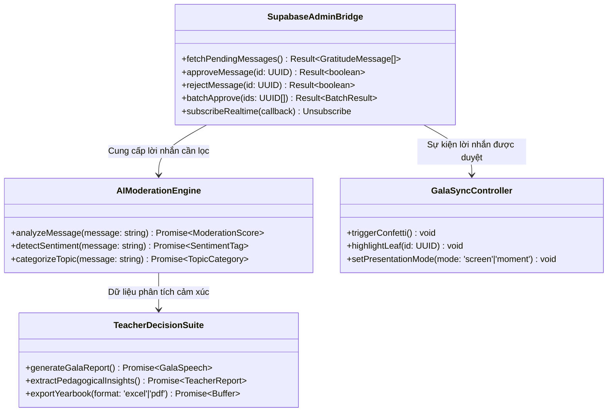

# BẢNG ÁNH XẠ MODULE CHI TIẾT
## CLAUDE GUI & CÂY TRI ÂN TÂY NGUYÊN INTEGRATION MAPPING

> **Tài liệu:** Bảng Ánh xạ Kỹ thuật Từng Module và Thành phần Tích hợp  
> **Phiên bản:** 1.0.0-PROPOSAL (Design & Preparation Phase)  
> **Ngày lập:** 17/11/2026  
> **Trạng thái:** DỰ THẢO THIẾT KẾ – CHỜ PHÊ DUYỆT (Chưa can thiệp mã nguồn)  
> **Mục tiêu:** Xác định vị trí đích, trạng thái chuyển đổi và vai trò kết nối của từng module thuộc Claude GUI (`E:\edukids-team`) với hệ sinh thái Cây Tri Ân Tây Nguyên (`E:\cay-tri-an-tay-nguyen`).

---

## 1. TỔNG QUAN PHÂN LOẠI TRẠNG THÁI MODULE

Toàn bộ các module trong hệ thống được phân loại theo 3 trạng thái rõ ràng:

1. **[GIỮ NGUYÊN - AS IS]:** Module được giữ nguyên cấu trúc logic, chỉ chuyển vị trí thư mục vào package tương ứng trong Monorepo, không sửa đổi logic nghiệp vụ cốt lõi.
2. **[CHUYỂN ĐỔI - REFACTOR]:** Module được tái cấu trúc (refactor/adapt) để mở rộng chức năng, phục vụ đồng thời cả tác vụ AI tổng quát và các nghiệp vụ đặc thù của Cây Tri Ân (như kiểm duyệt, phân tích cảm xúc, hỗ trợ giáo viên).
3. **[MỞ RỘNG MỚI - NEW ADAPTER]:** Module mới được tạo ra tại `packages/integration` hoặc `apps/platform-desktop` để kết nối trực tiếp hai không gian.

```
                                PHÂN BỔ TOÀN BỘ HỆ THỐNG
                                            │
        ┌───────────────────────────────────┼───────────────────────────────────┐
        ▼                                   ▼                                   ▼
 [ GIỮ NGUYÊN (60%) ]              [ CHUYỂN ĐỔI (30%) ]               [ MỞ RỘNG MỚI (10%) ]
 • Multi-Agent Roundtable          • AI Providers -> Multi-Provider   • Supabase Admin Bridge
 • Safe CLI Runner (shell: false)    Moderation Engine                • Teacher Decision Support Suite
 • URL Guard (Anti-SSRF)           • SQLite Schema -> Lưu thêm        • Unified Shell Navigation
 • safeStorage (DPAPI Encryption)    bản tin phân tích tri ân         • Gala Screen Sync Controller
 • 3D Virtual Classroom/Office     • Preload API -> Bổ sung kênh
 • Skills Engine (SKILL.md)          quản trị tri ân
 • Cây Tri Ân SVG Phyllotaxis      • Admin UI -> Cockpit 2 cột
```

---

## 2. MA TRẬN ÁNH XẠ CHI TIẾT TỪNG MODULE CỦA CLAUDE GUI

### 2.1. Phân hệ Lõi Thực Thi & Đa Tác Tử (`src/main/orchestrator/` & `claude/`)

| Đường dẫn gốc trong Claude GUI | Vị trí đích trong Monorepo | Trạng thái | Kết nối với thành phần nào của Cây Tri Ân? | Chức năng cụ thể trong Hệ thống Hợp nhất |
| :--- | :--- | :---: | :--- | :--- |
| `src/main/orchestrator/roundtable.ts` | `packages/claude-gui-core/src/orchestrator/roundtable.ts` | **[CHUYỂN ĐỔI]** | **Không gian AI & Hội đồng Sư phạm** | Điều phối bàn tròn thảo luận đa tác tử. Bổ sung kịch bản "Hội đồng Thầy cô": các tác tử đóng vai Giáo viên Ngữ văn, Cố vấn Đoàn trường, Chuyên gia Tâm lý cùng phân tích các thông điệp tri ân ý nghĩa. |
| `src/main/orchestrator/meeting-notes.ts` | `packages/claude-gui-core/src/orchestrator/meeting-notes.ts` | **[CHUYỂN ĐỔI]** | **Trang Báo cáo Kỷ yếu Sự kiện** | Tự động tổng hợp nội dung thảo luận và biên tập thành bài phát biểu tổng kết sự kiện 20/11 cho Ban Giám Hiệu. |
| `src/main/orchestrator/meeting-context.ts` | `packages/claude-gui-core/src/orchestrator/meeting-context.ts` | **[GIỮ NGUYÊN]** | **Bộ nhớ ngữ cảnh AI Studio** | Cung cấp ngữ cảnh dự án, thư mục tài liệu và lịch sử làm việc cho từng tác tử trong phiên họp. |
| `src/main/orchestrator/proposal.ts` & `proposal-step.ts` | `packages/claude-gui-core/src/orchestrator/proposal.ts` | **[GIỮ NGUYÊN]** | **Cơ chế đề xuất nhân sự AI** | Cho phép AI tự đề xuất thêm tác tử chuyên biệt (ví dụ: Tác tử Phân tích Thơ văn, Tác tử Quản trị Kỷ yếu) khi khối lượng lời nhắn tăng cao. |
| `src/main/orchestrator/mentions.ts` | `packages/claude-gui-core/src/orchestrator/mentions.ts` | **[GIỮ NGUYÊN]** | **Hệ thống Chat Điều hành** | Phát hiện cú pháp `@ten_tac_tu` trong khung chat để kích hoạt tác tử chuyên trách trả lời. |
| `src/main/orchestrator/single-chat.ts` | `packages/claude-gui-core/src/orchestrator/single-chat.ts` | **[GIỮ NGUYÊN]** | **Chế độ Trợ lý Riêng tư của Thầy Cô** | Phục vụ chế độ Solo Mode: Giáo viên làm việc 1-1 với một AI trợ lý để soạn bài, nghiên cứu tài liệu hoặc chấm phản hồi. |
| `src/main/claude/runner.ts` | `packages/claude-gui-core/src/runner/cli-runner.ts` | **[GIỮ NGUYÊN]** | **CLI Tooling & Hệ thống Kiểm thử** | Thực thi an toàn các lệnh hệ thống với `shell: false`, phân tách argv rõ ràng, chống Command Injection tuyệt đối. |
| `src/main/claude/stream-parser.ts` | `packages/claude-gui-core/src/runner/stream-parser.ts` | **[GIỮ NGUYÊN]** | **Luồng hiển thị câu trả lời AI** | Bóc tách từng token NDJSON thời gian thực từ CLI để hiển thị hiệu ứng gõ chữ mượt mà trên giao diện React. |
| `src/main/claude/environment.ts` | `packages/claude-gui-core/src/runner/environment.ts` | **[CHUYỂN ĐỔI]** | **Bộ phân giải đường dẫn Windows** | Bổ sung quét biến môi trường Windows `%PATH%`, registry và thư mục npm global trên Windows (`AppData/Roaming/npm`). |
| `src/main/claude/attachments.ts` | `packages/claude-gui-core/src/runner/attachments.ts` | **[CHUYỂN ĐỔI]** | **Bộ xử lý Tài liệu Kỷ yếu / Danh sách** | Hỗ trợ giáo viên kéo thả file Excel danh sách học sinh, file Word lời chúc vào khung chat để AI phân tích. |

---

### 2.2. Phân hệ Cổng AI Đa Nhà Cung Cấp (`src/main/providers/`)

| Đường dẫn gốc trong Claude GUI | Vị trí đích trong Monorepo | Trạng thái | Kết nối với thành phần nào của Cây Tri Ân? | Chức năng cụ thể trong Hệ thống Hợp nhất |
| :--- | :--- | :---: | :--- | :--- |
| `src/main/providers/gateway.ts` | `services/ai-gateway/src/gateway.ts` | **[CHUYỂN ĐỔI]** | **Trái tim điều phối AI toàn hệ thống** | Tiếp nhận yêu cầu từ cả AI Studio và Bộ kiểm duyệt Cây Tri Ân; tự động định tuyến đến nhà cung cấp tối ưu nhất (Gemini Flash cho kiểm duyệt nhanh, Claude Sonnet cho phân tích chuyên sâu). |
| `src/main/providers/gemini-adapter.ts` | `services/ai-gateway/src/providers/gemini-adapter.ts` | **[CHUYỂN ĐỔI]** | **Module Kiểm duyệt Siêu tốc (Speed Moderation)** | Sử dụng Gemini Flash (chi phí cực rẻ, tốc độ dưới 500ms) để đọc quét lời nhắn `pending` và trả về nhãn độc hại/an toàn. |
| `src/main/providers/anthropic-adapter.ts` | `services/ai-gateway/src/providers/anthropic-adapter.ts` | **[GIỮ NGUYÊN]** | **Module Phân tích Cảm xúc Chuyên sâu** | Kết nối Claude 3.7 Sonnet / Haiku để phân tích chiều sâu triết lý, giá trị nhân văn và phong cách biểu đạt của học sinh. |
| `src/main/providers/agy-adapter.ts` | `services/ai-gateway/src/providers/agy-adapter.ts` | **[GIỮ NGUYÊN]** | **Google Antigravity CLI Integration** | Thực thi tương tác AI qua CLI chính thức của Google trong môi trường sandbox an toàn. |
| `src/main/providers/openai-adapter.ts` & `codex-adapter.ts` | `services/ai-gateway/src/providers/openai-adapter.ts` | **[GIỮ NGUYÊN]** | **Dự phòng Đa nguồn (Fallback AI)** | Cho phép sử dụng OpenAI API (GPT-4o, o3-mini) hoặc Codex CLI khi người dùng nhập khóa OpenAI. |
| `src/main/providers/model-catalog.ts` | `services/ai-gateway/src/model-catalog.ts` | **[GIỮ NGUYÊN]** | **Giao diện Cài đặt Mô hình** | Cung cấp danh mục mô hình, chi phí token và giới hạn context window cho màn hình Settings. |

---

### 2.3. Phân hệ An Ninh, Phân Quyền & Lưu Trữ Khóa (`src/main/security/`)

| Đường dẫn gốc trong Claude GUI | Vị trí đích trong Monorepo | Trạng thái | Kết nối với thành phần nào của Cây Tri Ân? | Chức năng cụ thể trong Hệ thống Hợp nhất |
| :--- | :--- | :---: | :--- | :--- |
| `src/main/security/secret-box.ts` | `packages/shared/src/security/secret-box.ts` | **[CHUYỂN ĐỔI]** | **Lưu trữ an toàn Khóa Quản trị Supabase & API Key** | Sử dụng Windows DPAPI / macOS Keychain để mã hóa: (1) Supabase Admin JWT Token, (2) LLM API Keys. Không lưu văn bản thô (plaintext) ra file. |
| `src/main/security/permissions.ts` & `permission-policy.ts` | `apps/platform-desktop/src/main/security/permissions.ts` | **[GIỮ NGUYÊN]** | **Lá chắn An ninh Electron** | Chặn toàn bộ quyền truy cập nguy hiểm (camera, định vị, cảm biến, mở file tự do); chỉ cho phép microphone có kiểm tra nguồn gốc URL. |
| `src/main/search/url-guard.ts` | `packages/shared/src/security/url-guard.ts` | **[GIỮ NGUYÊN]** | **Bộ lọc Chống SSRF & Link độc hại** | Kiểm tra toàn bộ đường dẫn website mà học sinh có thể gửi kèm trong lời nhắn; chặn hoàn toàn các dải IP nội bộ và loopback. |

---

### 2.4. Phân hệ Cơ Sở Dữ Liệu Cục Bộ (`src/main/db/`)

| Đường dẫn gốc trong Claude GUI | Vị trí đích trong Monorepo | Trạng thái | Kết nối với thành phần nào của Cây Tri Ân? | Chức năng cụ thể trong Hệ thống Hợp nhất |
| :--- | :--- | :---: | :--- | :--- |
| `src/main/db/connection.ts` & `schema.ts` | `apps/platform-desktop/src/main/db/` | **[CHUYỂN ĐỔI]** | **Bộ nhớ Đệm Ngoại Tuyến (Offline Local Cache)** | Sử dụng `better-sqlite3` để lưu: (1) Lịch sử hội thoại AI, (2) Cấu hình các nhóm tác tử, (3) Bản sao lưu cục bộ (Local Snapshot) của các lời nhắn đã duyệt để phục vụ hiển thị Gala ngay cả khi mất mạng. |
| `src/main/db/queries.ts` | `apps/platform-desktop/src/main/db/queries.ts` | **[GIỮ NGUYÊN]** | **Truy vấn Lịch sử Hội thoại** | Quản lý thêm/xóa/sửa hội thoại, tin nhắn chat và đính kèm file trong không gian AI Studio. |
| `src/main/db/companies.ts` & `member-skills.ts` | `apps/platform-desktop/src/main/db/teams.ts` | **[GIỮ NGUYÊN]** | **Quản lý Tổ Tác Tử Chuyên Môn** | Lưu trữ danh sách nhóm tác tử AI (ví dụ: Tổ Toán - Tin, Tổ Xã hội Nhân văn, Ban Kiểm duyệt). |

---

### 2.5. Phân hệ Kỹ Năng & Hàng Đợi (`src/main/skills/` & `queue/`)

| Đường dẫn gốc trong Claude GUI | Vị trí đích trong Monorepo | Trạng thái | Kết nối với thành phần nào của Cây Tri Ân? | Chức năng cụ thể trong Hệ thống Hợp nhất |
| :--- | :--- | :---: | :--- | :--- |
| `src/main/skills/disk.ts` & `library.ts` | `packages/claude-gui-core/src/skills/` | **[CHUYỂN ĐỔI]** | **Kho Kỹ Năng Giáo Dục (Education Skills Catalog)** | Nạp các file `SKILL.md` định nghĩa chuyên môn của từng trợ lý (Ví dụ: `pedagogical-analysis.skill.md`, `sentiment-auditor.skill.md`). |
| `src/main/queue/runner.ts` & `jobs.ts` | `packages/claude-gui-core/src/queue/` | **[CHUYỂN ĐỔI]** | **Hàng đợi Xử lý Kiểm duyệt Hàng loạt** | Khi có 500 lời nhắn cùng gửi về, hàng đợi sẽ phân bổ tuần tự từng lô (batch) 10 tin nhắn cho AI phân tích, tránh gây nghẽn mạng và vượt rate limit. |

---

### 2.6. Phân hệ Xử Lý Giọng Nói (`src/main/voice/`)

| Đường dẫn gốc trong Claude GUI | Vị trí đích trong Monorepo | Trạng thái | Kết nối với thành phần nào của Cây Tri Ân? | Chức năng cụ thể trong Hệ thống Hợp nhất |
| :--- | :--- | :---: | :--- | :--- |
| `src/main/voice/transcribe.ts` & `local-whisper.ts` | `packages/claude-gui-core/src/voice/` | **[GIỮ NGUYÊN]** | **Nhập Lời Nhắn Tri Ân Bằng Giọng Nói (Voice-to-Text)** | Cho phép thầy cô hoặc người điều hành tại Gala đọc lệnh điều khiển hoặc đọc lời chúc trực tiếp bằng micro mà không cần gõ phím. |

---

### 2.7. Phân hệ Giao Diện Người Dùng (`src/renderer/src/components/`)

| Component gốc trong Claude GUI | Vị trí đích trong Monorepo | Trạng thái | Kết nối với thành phần nào của Cây Tri Ân? | Chức năng cụ thể trong Hệ thống Hợp nhất |
| :--- | :--- | :---: | :--- | :--- |
| `src/renderer/src/App.tsx` | `apps/platform-desktop/src/renderer/App.tsx` | **[CHUYỂN ĐỔI]** | **Unified Shell Điều Hướng** | Đóng vai trò vỏ bọc chính, chứa thanh chuyển đổi đỉnh màn hình giữa Không gian Tri Ân và Không gian AI Studio. |
| `components/chat/ChatPane.tsx` | `packages/ai-studio/src/components/chat/ChatPane.tsx` | **[GIỮ NGUYÊN]** | **Khung Chat Không gian AI** | Hiển thị luồng hội thoại với AI, hỗ trợ render công thức Toán KaTeX, Markdown GFM, code highlight và các khối suy luận (Reasoning Block). |
| `components/office/OfficeView.tsx` | `packages/ai-studio/src/components/office/OfficeView.tsx` | **[GIỮ NGUYÊN]** | **Phòng Họp & Lớp Học Ảo 3D** | Render mô hình 3D tương tác bằng Three.js (Lazy-loaded, chỉ nạp khi người dùng mở tab 3D Office để tiết kiệm RAM). |
| `components/sidebar/Sidebar.tsx` | `packages/ai-studio/src/components/sidebar/Sidebar.tsx` | **[GIỮ NGUYÊN]** | **Thanh Điều hướng Dự án AI** | Quản lý cây thư mục dự án, danh sách các cuộc hội thoại và chuyển đổi giữa các nhóm tác tử. |
| `components/company/CompanyManagerModal.tsx` | `packages/ai-studio/src/components/company/TeamModal.tsx` | **[CHUYỂN ĐỔI]** | **Quản lý Tổ Tác Tử Giáo Dục** | Giao diện cấu hình thành viên trong ban cố vấn AI, gán mô hình và gán kỹ năng chuyên môn cho từng chuyên gia. |
| `components/settings/SettingsDialog.tsx` | `apps/platform-desktop/src/renderer/components/Settings.tsx` | **[CHUYỂN ĐỔI]** | **Cài đặt Hệ thống Hợp nhất** | Cấu hình toàn diện: Kết nối Supabase URL/Key, cài đặt AI Provider API Keys, tùy chọn giao diện sáng/tối. |

---

## 3. CÁC MODULE MỞ RỘNG MỚI (NEW INTEGRATION PACKAGES)

Để hai dự án hoạt động trơn tru như một thể thống nhất, 4 module cầu nối mới được thiết kế tại `packages/integration`:



### 3.1. `SupabaseAdminBridge` (`packages/integration/src/supabase-bridge/`)
* **Mục đích:** Đóng gói toàn bộ kết nối từ Desktop Cockpit tới Supabase qua tài khoản xác thực GoTrue (email/mật khẩu).
* **Đặc tính an toàn:** Sử dụng Bearer JWT ngắn hạn, tự động refresh token, không bao giờ dùng `service_role`.

### 3.2. `AIModerationEngine` (`packages/integration/src/moderation/`)
* **Mục đích:** Cầu nối giữa danh sách tin nhắn chờ duyệt và AI Gateway.
* **Đặc tính:** Gửi prompt kiểm duyệt chuẩn sư phạm, phân tích mức độ thô tục, công kích cá nhân, spam, và trích xuất cảm xúc tích cực.

### 3.3. `TeacherDecisionSuite` (`packages/integration/src/teacher-assistant/`)
* **Mục đích:** Bộ công cụ trợ lý chuyên sâu phục vụ Ban Giám Hiệu và Giáo viên:
  * Phân tích các phẩm chất mà học sinh ấn tượng nhất ở thầy cô.
  * Tự động tạo bài phát biểu Gala tri ân giàu cảm xúc.
  * Xuất toàn bộ dữ liệu lời nhắn đã duyệt thành kỷ yếu số định dạng Excel hoặc PDF.

### 3.4. `GalaSyncController` (`packages/integration/src/event-display/`)
* **Mục đích:** Điều khiển màn hình trình chiếu tại hội trường Gala:
  * Cho phép người điều hành trên Desktop Cockpit bấm chọn một lời nhắn nổi bật để phóng to trên màn hình lớn.
  * Điều khiển hiệu ứng pháo hoa giấy (confetti) hoặc làm bừng sáng đóa hoa dã quỳ tương ứng trên Cây Tri Ân.

---

## 4. TỔNG KẾT VÀ NGUYÊN TẮC LIÊN KẾT DỮ LIỆU

1. **Không can thiệp vào Web Cây Tri Ân gốc:** Toàn bộ code trong `apps/gratitude-web` tiếp tục đọc và ghi dữ liệu độc lập với Supabase qua REST PostgREST.
2. **Desktop Cockpit là người giám sát cấp cao:** Ứng dụng Desktop (chứa Claude GUI Core + AI Studio) đóng vai trò là trạm quản trị và trung tâm nghiên cứu, kết nối với Supabase bằng quyền Admin có kiểm soát.
3. **Mọi module Claude GUI đều tìm thấy vai trò thiết thực:** Không có module nào của Claude GUI bị lãng phí; từ Three.js 3D (dùng cho phòng học ảo), CLI Runner (dùng cho công cụ dev/test), đến Multi-Agent Roundtable (dùng cho hội đồng phân tích sư phạm) đều phục vụ đắc lực cho mục tiêu chung của Nền tảng Cây Tri Ân Tây Nguyên.
