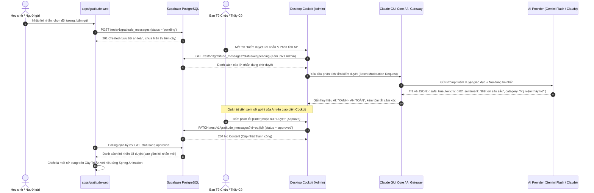

# KIẾN TRÚC HỢP NHẤT: CÂY TRI ÂN TÂY NGUYÊN PLATFORM
## UNIFIED ARCHITECTURE SPECIFICATION

> **Tài liệu:** Thiết kế Kiến trúc Kỹ thuật Hệ thống Hợp nhất  
> **Phiên bản:** 1.0.0-PROPOSAL (Design & Preparation Phase)  
> **Ngày lập:** 17/11/2026  
> **Trạng thái:** DỰ THẢO THIẾT KẾ – CHỜ PHÊ DUYỆT (Chưa áp dụng code)  
> **Phạm vi hợp nhất:**  
> - Dự án A: `E:\edukids-team` (Claude GUI – Multi-Agent Desktop Platform)  
> - Dự án B: `E:\cay-tri-an-tay-nguyen` (Báo tường điện tử Cây Tri Ân Tây Nguyên)

---

## 1. TỔNG QUAN VÀ TẦM NHÌN SẢN PHẨM

### 1.1. Tầm nhìn chiến lược
**CÂY TRI ÂN TÂY NGUYÊN PLATFORM** là nền tảng số hóa giáo dục thế hệ mới, kết hợp hài hòa giữa **Giá trị Văn hóa & Tri ân Truyền thống** với **Năng lực Trí tuệ Nhân tạo Đa tác tử (Multi-Agent AI)** tân tiến.

Sản phẩm giải quyết bài toán cốt lõi: Làm thế nào để vừa duy trì một website báo tường tri ân siêu nhẹ, gần gũi, chạy tức thì trên điện thoại di động của hàng ngàn học sinh – sinh viên, vừa trang bị cho Nhà trường và Ban Tổ Chức một "Trung tâm Chỉ huy & Đổi mới Sáng tạo AI" (AI Innovation Studio) mạnh mẽ, hỗ trợ nghiên cứu, thống kê, kiểm duyệt và ra quyết định.

```
+---------------------------------------------------------------------------------------------------+
|                                CÂY TRI ÂN TÂY NGUYÊN PLATFORM                                     |
+---------------------------------------------------------------------------------------------------+
|  [ TOP-LEVEL UNIFIED NAVIGATION / SHELL SWITCHER: GRATITUDE SPACE <---> AI INNOVATION SPACE ]     |
+-------------------------------------------------+-------------------------------------------------+
|          KHÔNG GIAN 1: GRATITUDE SPACE          |       KHÔNG GIAN 2: AI INNOVATION SPACE         |
|             (Báo Tường Tri Ân Điện Tử)           |           (Trung Tâm Đổi Mới AI Đa Tác Tử)       |
+-------------------------------------------------+-------------------------------------------------+
| - Cây Tri Ân SVG Fibonacci Phyllotaxis tương tác| - Multi-Agent Roundtable & Proposal System      |
| - Gửi lời tri ân (Có tên / Ẩn danh) 3 bước      | - AI Gateway Đa nhà cung cấp (Gemini, Claude,   |
| - Quy trình kiểm duyệt tin nhắn (Pending/Approve) |   OpenAI, Codex, AGY CLI, OpenCode)            |
| - Màn hình trình chiếu Gala Offline Canvas QR   | - CLI Runner an toàn (shell: false, argv guard) |
| - Supabase PostgreSQL BaaS + Row Level Security | - Công cụ Trợ lý Giáo viên (Nghiên cứu, Phân    |
| - Phong cách mỹ thuật Màu nước & Hoa Dã Quỳ     |   tích cảm xúc lời tri ân, Thống kê, Báo cáo)   |
| - Triển khai tĩnh 100% trên GitHub Pages/Mobile | - Desktop Cockpit (Electron + Node.js + SQLite) |
+-------------------------------------------------+-------------------------------------------------+
```

### 1.2. Các nguyên tắc kiến trúc bất biến (Invariants)
1. **Zero Degradation (Không suy giảm chất lượng gốc):** Website Cây Tri Ân không được tăng dung lượng tải, không phụ thuộc vào Node runtime khi chạy trên mobile web. Trải nghiệm quét QR dùng ngay phải được bảo tồn tuyệt đối.
2. **Zero Security Bypass (Không thỏa hiệp bảo mật):** Không bao giờ đưa `service_role` key của Supabase hay LLM API key vào mã nguồn phân phối hoặc frontend public. Supabase RLS giữ nguyên 100%.
3. **No Direct Node/Electron API in Browser (Cách ly môi trường):** Tuyệt đối không gọi IPC hay Electron API từ trình duyệt web thuần. Việc tương tác giữa hai không gian được trừu tượng hóa qua các Adapter và Gateway rõ ràng.
4. **Human-in-the-Loop (Con người nắm quyền quyết định tối cao):** Trí tuệ nhân tạo chỉ đóng vai trò phân tích, hỗ trợ và đề xuất; không cho phép AI tự động xóa dữ liệu hoặc tự động chuyển trạng thái `approved` lên production mà không có sự xác nhận của quản trị viên.
5. **Decoupled Independence (Khả năng phát triển và triển khai độc lập):** Kiến trúc Monorepo cho phép phát triển, kiểm thử, build và deploy từng ứng dụng (`apps/gratitude-web` và `apps/platform-desktop`) một cách độc lập.

---

## 2. KIẾN TRÚC MONOREPO ĐỀ XUẤT

Để tổ chức mã nguồn có khả năng mở rộng lâu dài, hệ thống được cấu trúc theo mô hình Monorepo (sử dụng pnpm workspaces hoặc npm workspaces):

```
cay-tri-an-tay-nguyen-platform/
├── apps/
│   ├── gratitude-web/                   # ỨNG DỤNG WEB CÂY TRI ÂN (KHÔNG GIAN 1)
│   │   ├── index.html                   # Giao diện chính cây tri ân (Phyllotaxis SVG)
│   │   ├── admin.html                   # Giao diện web quản trị truyền thống
│   │   ├── qr.html                      # Trang hiển thị mã QR cỡ lớn cho sự kiện
│   │   ├── style.css                    # Thiết kế màu nước, typography Tây Nguyên
│   │   ├── qr-page.css                  # CSS chuyên biệt cho trang QR
│   │   ├── app.js                       # Logic tương tác cây, form gieo mầm, Supabase client
│   │   ├── qr.js                        # Bộ sinh mã QR Canvas độc lập offline
│   │   ├── config.js                    # Cấu hình Supabase anon key & URL
│   │   └── assets/                      # Hình ảnh, logo Đoàn, lá, hoa dã quỳ
│   │
│   └── platform-desktop/                # ỨNG DỤNG DESKTOP COCKPIT (CHỨA CẢ HAI KHÔNG GIAN)
│       ├── package.json                 # Cấu hình Electron + React 19 Desktop Shell
│       ├── electron-builder.yml         # Cấu hình đóng gói EXE (Windows) / DMG / AppImage
│       ├── electron.vite.config.ts      # Build pipeline cho Main, Preload và Renderer
│       ├── src/
│       │   ├── main/                    # Electron Main Process (Node.js runtime an toàn)
│       │   │   ├── index.ts             # Khởi tạo BrowserWindow, áp dụng CSP & Permissions
│       │   │   ├── security/            # permissions.ts, secret-box.ts (DPAPI/safeStorage)
│       │   │   ├── ipc/                 # IPC handlers whitelist phân cấp
│       │   │   └── bridge/              # Bộ điều phối giữa Core và Desktop Shell
│       │   ├── preload/                 # contextBridge cách ly ngữ cảnh (window.api)
│       │   │   └── index.ts
│       │   └── renderer/                # React 19 Frontend Shell (Unified Navigation)
│       │       ├── App.tsx              # Shell điều hướng chung (Tab Switcher)
│       │       ├── spaces/
│       │       │   ├── GratitudeEmbed.tsx   # Tích hợp Không gian 1 trong Desktop Cockpit
│       │       │   └── InnovationSpace.tsx # Không gian 2 (AI Studio)
│       │       └── components/          # TopBar, StatusBar, NavigationPill
│
├── packages/
│   ├── claude-gui-core/                 # LÕI THỰC THI AI & ORCHESTRATION (TÁCH TỪ EDUKIDS-TEAM)
│   │   ├── package.json
│   │   ├── src/
│   │   │   ├── orchestrator/            # Multi-Agent Roundtable, Meeting Notes, Pipeline
│   │   │   ├── runner/                  # CLI Runner an toàn (spawn shell: false, argv check)
│   │   │   ├── queue/                   # Hàng đợi tác vụ (prompt-queue, job-state)
│   │   │   ├── search/                  # Công cụ tìm kiếm web an toàn + url-guard
│   │   │   ├── skills/                  # Thư viện và cơ chế nạp kỹ năng SKILL.md
│   │   │   └── voice/                   # Xử lý âm thanh offline Whisper
│   │
│   ├── ai-studio/                       # GIAO DIỆN REACT AI STUDIO (RENDERER REUSABLE)
│   │   ├── package.json
│   │   ├── src/
│   │   │   ├── components/              # ChatPane, Composer, ActiveSpeakerBar, Turn
│   │   │   ├── office/                  # 3D Virtual Classroom / Office (Three.js lazy loaded)
│   │   │   ├── teacher-tools/           # Module hỗ trợ giáo viên (Phân tích, Thống kê, Báo cáo)
│   │   │   ├── hooks/                   # useChatStream, useCompanyStream, useOfficeState
│   │   │   └── styles/                  # Tailwind v4 tokens & components
│   │
│   ├── integration/                     # BỘ KẾT NỐI GIỮA AI VÀ CÂY TRI ÂN
│   │   ├── package.json
│   │   ├── src/
│   │   │   ├── moderation/              # AI Content Moderation Engine (Phân tích độc hại, cảm xúc)
│   │   │   ├── teacher-assistant/       # Bộ kỹ năng AI phân tích chủ đề, bài học sư phạm
│   │   │   ├── supabase-bridge/         # Client an toàn giao tiếp Supabase qua JWT Admin
│   │   │   └── event-display/           # Cầu nối điều khiển màn hình trình chiếu Gala
│   │
│   └── shared/                          # TYPES & TIÊU CHUẨN DÙNG CHUNG
│       ├── package.json
│       ├── src/
│       │   ├── types.ts                 # Type definitions: GratitudeMessage, Company, Member
│       │   ├── ipc.ts                   # Hằng số kênh IPC whitelist
│       │   ├── result.ts                # Chuẩn đóng gói Result<T> = { ok: true, data } | { ok: false, error }
│       │   └── permissions.ts           # Định nghĩa vai trò (Guest, Teacher, SuperAdmin)
│
├── services/
│   └── ai-gateway/                      # DỊCH VỤ ĐIỀU PHỐI MÔ HÌNH NGÔN NGỮ (MULTI-PROVIDER)
│       ├── package.json
│       ├── src/
│       │   ├── gateway.ts               # Dispatcher thông minh: Gemini, Claude, OpenAI, Codex, AGY
│       │   ├── providers/               # Adapters (Anthropic, Gemini, OpenAI, AGY CLI)
│       │   ├── model-catalog.ts         # Danh mục mô hình và kiểm tra hạn mức
│       │   └── rate-limiter.ts          # Bộ kiểm soát tốc độ và phòng chống vượt quota
│
├── database/
│   ├── supabase/
│   │   └── schema.sql                   # Định nghĩa bảng public.gratitude_messages + RLS
│   └── sqlite/
│       └── schema.sql                   # SQLite cục bộ cho Desktop (lưu lịch sử chat, cache)
│
├── tests/
│   ├── unit/                            # Unit tests thuần Node.js (37 bài test kế thừa)
│   ├── integration/                     # Kiểm thử liên thông giữa AI Moderation và Supabase
│   ├── smoke/                           # Web smoke test + Desktop smoke test
│   └── ui/                              # Headless visual & DOM regression test
│
├── docs/                                # TOÀN BỘ TÀI LIỆU THIẾT KẾ & HƯỚNG DẪN
│   ├── UNIFIED_ARCHITECTURE.md          # Tài liệu này
│   ├── MIGRATION_PLAN.md                # Kế hoạch di chuyển mã nguồn
│   ├── MODULE_MAPPING.md                # Ánh xạ chi tiết từng module
│   ├── SECURITY_DESIGN.md               # Thiết kế an ninh và phân quyền
│   └── INTEGRATION_ROADMAP.md           # Lộ trình tích hợp từng bước
│
├── package.json                         # Root Workspace Config
├── tsconfig.base.json                   # Cấu hình TypeScript chia sẻ
├── eslint.config.mjs                    # Bộ quy chuẩn linter thống nhất
└── README.md                            # Tổng quan sản phẩm và hướng dẫn khởi chạy
```

---

## 3. SƠ ĐỒ LUỒNG DỮ LIỆU VÀ GIAO TIẾP HỆ THỐNG

### 3.1. Sơ đồ tương tác tổng thể (Global System Architecture)

```mermaid
flowchart TB
    subgraph Mobile_Web_Zone["🌐 KHÔNG GIAN 1: PUBLIC MOBILE WEB (GitHub Pages)"]
        direction TB
        M_User["📱 Học sinh / Sinh viên (Mobile Browser)"] -->|1. Quét QR / Truy cập| Web_Gratitude["apps/gratitude-web (index.html)"]
        Web_Gratitude -->|2. POST lời nhắn (status='pending')| Supabase_PostgREST
        Web_Gratitude -->|3. GET lời nhắn (status='approved', poll 8s)| Supabase_PostgREST
        Gala_Screen["🖥️ Màn hình Chiếu Gala (?screen=1)"] -->|Hiển thị QR & Lá nảy mầm| Web_Gratitude
    end

    subgraph BaaS_Cloud_Zone["☁️ PHÂN HỆ DỮ LIỆU ĐÁM MÂY (Supabase BaaS)"]
        direction TB
        Supabase_PostgREST["Supabase PostgREST Engine"]
        Supabase_RLS["Row Level Security Engine (RLS)"]
        Supabase_DB[("PostgreSQL: public.gratitude_messages")]
        Supabase_Auth["GoTrue Auth Service (Admin JWT)"]

        Supabase_PostgREST <--> Supabase_RLS <--> Supabase_DB
        Supabase_Auth <--> Supabase_DB
    end

    subgraph Desktop_Platform_Zone["💻 KHÔNG GIAN 2 & QUẢN TRỊ: PLATFORM DESKTOP COCKPIT (Electron + Node.js)"]
        direction TB
        subgraph Renderer_Space["Renderer Process (React 19 + Tailwind v4 + Three.js)"]
            Unified_Nav["Unified Shell Navigation: [Tab 1: Gratitude Space] | [Tab 2: AI Innovation Space]"]
            Gratitude_Embed["Gratitude Cockpit: Danh sách tin nhắn + Bộ lọc + Preview lá 2D"]
            AI_Studio_UI["packages/ai-studio: Chat Multi-Agent, Roundtable, 3D Virtual Classroom"]
            Teacher_Tools["Teacher Suite: Phân tích cảm xúc, Trích xuất chuyên đề, Thống kê sư phạm"]
        end

        subgraph Preload_Boundary["Preload Isolation Barrier (contextBridge)"]
            API_Bridge["window.api (Strict Whitelisted IPC Channels Only)"]
        end

        subgraph Main_Process_Space["Main Process (Node.js 22 Runtime)"]
            IPC_Router["Main IPC Router (Type-safe handlers)"]
            SafeStorage["Electron safeStorage (DPAPI Encrypted Keys)"]
            Core_Engine["packages/claude-gui-core (Runner, Orchestrator, Queue)"]
            AI_Gateway["services/ai-gateway (Gemini, Claude, OpenAI, AGY CLI)"]
            Local_DB[("better-sqlite3: History, Caches, Preferences")]
        end

        Unified_Nav --> Gratitude_Embed & AI_Studio_UI & Teacher_Tools
        Gratitude_Embed & AI_Studio_UI & Teacher_Tools --> API_Bridge
        API_Bridge --> IPC_Router
        IPC_Router <--> SafeStorage & Core_Engine & AI_Gateway & Local_DB
    end

    %% Inter-tier data links
    Supabase_PostgREST <==>|4. Fetch tin nhắn pending & Gửi lệnh duyệt (Kèm JWT)| IPC_Router
    IPC_Router ==>|5. Gửi nội dung tin nhắn cần phân tích| AI_Gateway
    AI_Gateway ==>|6. Trả về kết quả đánh giá (Độc hại, Cảm xúc, Chủ đề)| IPC_Router
    IPC_Router ==>|7. Đẩy kết quả AI gợi ý lên UI Quản trị viên| API_Bridge
```

### 3.2. Luồng giao tiếp Kiểm duyệt Thông minh (AI-Assisted Gratitude Moderation Flow)

Luồng nghiệp vụ đảm bảo: **AI chỉ đóng vai trò Trợ lý đề xuất (Advisory Copilot), Quản trị viên luôn là người bấm nút xác nhận cuối cùng.**



---

## 4. CHI TIẾT TỪNG PHÂN HỆ VÀ THIẾT KẾ ĐA NỀN TẢNG

### 4.1. Phân hệ 1: `apps/gratitude-web` (Không gian Tri Ân)
* **Tính chất:** Pure Web Application, Zero-build dependency (có thể copy chạy ngay trên bất kỳ máy chủ HTTP tĩnh nào hoặc GitHub Pages).
* **Đặc tả kỹ thuật:**
  * HTML5 Semantic kết hợp SVG Canvas Vector tương tác.
  * Thuật toán phân bố góc vàng Fibonacci Phyllotaxis ($\theta \approx 137.507764^\circ$) tạo vòm lá tự nhiên, mở rộng vô hạn theo số lượng tin nhắn duyệt.
  * Bộ sinh số ngẫu nhiên xác định Mulberry32 PRNG cố định màu sắc lá/hoa theo chuỗi ID của tin nhắn.
  * Bộ sinh mã QR Canvas ngoại tuyến `qr.js` không phụ thuộc internet ngoại vi.
  * Giao tiếp trực tiếp với PostgREST qua `fetch()`, không nạp SDK nặng nề.

### 4.2. Phân hệ 2: `apps/platform-desktop` (Vỏ bọc Hợp nhất Đa Không gian)
* **Tính chất:** Electron 39 Desktop Shell, cung cấp môi trường bảo mật Node.js để kết nối hai không gian.
* **Cơ chế chuyển đổi không gian (Space Navigation Bar):**
  * Giao diện đỉnh màn hình (Top Header) tích hợp thanh chuyển đổi trạng thái:
    * **Tab 1: Gratitude Space (Cây Tri Ân):** Nhúng trực tiếp bản hiển thị của Cây Tri Ân, đồng thời mở rộng thanh công cụ quản trị cấp cao (bộ lọc, duyệt hàng loạt, xuất file kỷ yếu Excel/CSV, chế độ màn hình chiếu Gala 4K).
    * **Tab 2: AI Innovation Space (AI Studio):** Mở ra môi trường làm việc thông minh kế thừa toàn bộ sức mạnh của Claude GUI.
* **Môi trường chạy đa nền tảng:**
  * Tối ưu hóa đặc biệt cho **Windows 10/11** (sử dụng PowerShell CLI resolution, Windows DPAPI qua `safeStorage`, và đóng gói chuẩn NSIS `.exe`).
  * Tương thích hoàn chỉnh với macOS (Apple Silicon / Intel) và Linux.

### 4.3. Phân hệ 3: `packages/claude-gui-core` (Lõi Trí Tuệ Nhân Tạo)
* **Nhiệm vụ:** Độc lập với giao diện đồ họa, chứa toàn bộ thuật toán điều phối đa tác tử:
  * **Multi-Agent Orchestrator:** Cơ chế bàn tròn (`roundtable.ts`), ghi biên bản cuộc họp tự động (`meeting-notes.ts`), chia sẻ ngữ cảnh thảo luận (`meeting-context.ts`).
  * **Proposal System:** Cơ chế cho phép các tác tử AI tự đề xuất nhân sự mới hoặc kỹ năng mới cho tổ chức (`proposal.ts`).
  * **Safe CLI Runner:** Thực thi các lệnh CLI hệ thống với cờ `shell: false` triệt tiêu nguy cơ Command Injection.
  * **URL Guard & Search:** Bộ lọc kiểm soát truy cập mạng, chặn đứng tấn công SSRF vào mạng nội bộ trường học.

### 4.4. Phân hệ 4: `packages/ai-studio` (Không gian Đổi mới Sáng tạo)
* **Nhiệm vụ:** Giao diện người dùng tương tác cao trên nền React 19:
  * **AI Chat đa vai trò:** Thảo luận 1-1 (Solo Mode) hoặc thảo luận nhóm (Team Mode) với các chuyên gia ảo.
  * **3D Virtual Classroom / Office:** Tái hiện không gian làm việc và lớp học ảo 3D bằng Three.js (`@react-three/fiber`), hỗ trợ hiển thị trạng thái phát biểu của từng chuyên gia AI.
  * **Bộ công cụ Hỗ trợ Nghiên cứu dành cho Thầy Cô (Teacher AI Suite):**
    * *Trợ lý Phân tích Cảm xúc Lời nhắn:* Thống kê mức độ lan tỏa tích cực, những chủ đề mà học sinh tri ân nhiều nhất (sự tận tụy, bài học cuộc sống, kỷ niệm dưới mái trường).
    * *Trợ lý Báo cáo & Kỷ yếu:* Tự động biên tập các lời nhắn hay nhất thành bài phát biểu Gala hoặc kỷ yếu số 20/11.
    * *Trợ lý Nghiên cứu & Giảng dạy:* Soạn giáo án, lập kế hoạch nghiên cứu khoa học, tóm tắt tài liệu học thuật.

### 4.5. Phân hệ 5: `services/ai-gateway` (Cổng Điều phối Mô hình Ngôn ngữ)
* **Hỗ trợ đa nhà cung cấp đồng thời:**
  * **Google Gemini API** (Gemini 2.5/3.0 Pro, Gemini 2.5 Flash).
  * **Google Antigravity CLI** (`agy` CLI với sandbox an toàn).
  * **Anthropic Claude API & CLI** (Claude 3.7 Sonnet, Claude 3.5 Haiku, Claude 3 Opus).
  * **OpenAI API & Codex CLI** (GPT-4o, o3-mini).
  * **Mô hình mã nguồn mở nội bộ** qua Ollama, DeepSeek hoặc OpenCode.
* **Cơ chế dự phòng (Failover & Fallback):** Khi một nhà cung cấp cạn token hoặc gặp sự cố mạng, hệ thống tự động cảnh báo và chuyển hướng linh hoạt sang nhà cung cấp phụ trợ.

---

## 5. THIẾT KẾ GIAO DIỆN VÀ TRẢI NGHIỆM ĐIỀU HƯỚNG THỐNG NHẤT

### 5.1. Cấu trúc Layout Điều Hướng Shell
```
+-----------------------------------------------------------------------------------------------------+
| [LOGO PLATFORM]   CÂY TRI ÂN TÂY NGUYÊN PLATFORM     (•) Online   [?] Help   [-] [口] [X]           |
|                                                                                                     |
|  NAV:  [ 🌿 GRATITUDE SPACE (CÂY TRI ÂN) ]    [ 🤖 AI INNOVATION STUDIO ]   [ ⚙️ HỆ THỐNG ]         |
+-----------------------------------------------------------------------------------------------------+
|                                                                                                     |
|  KHI CHỌN TAB "GRATITUDE SPACE":                                                                   |
|  +-------------------------------------------------------+---------------------------------------+  |
|  | CÂY TRI ÂN INTERACTIVE VIEW (SVG / PREVIEW)           | TRUNG TÂM DUYỆT & THỐNG KÊ TRI ÂN     |  |
|  | - Hiển thị đồ họa cây tri ân thời gian thực           | - Danh sách lời nhắn Chờ duyệt        |  |
|  | - Nút chuyển chế độ Trình chiếu Gala (?screen=1)      | - Huy hiệu gợi ý từ AI Moderation     |  |
|  | - Nút bật mã QR tương tác cho hội trường             | - Phím tắt [Enter] Duyệt / [Del] Hủy  |  |
|  | - Thống kê nhanh: 1,250 Lá xanh | 450 Dã quỳ nở      | - Xuất dữ liệu Kỷ yếu Excel / PDF     |  |
|  +-------------------------------------------------------+---------------------------------------+  |
|                                                                                                     |
|  KHI CHỌN TAB "AI INNOVATION STUDIO":                                                              |
|  +-----------------------+---------------------------------------------------+--------------------+  |
|  | MULTI-AGENT SIDEBAR   | MAIN CONVERSATION / 3D VIRTUAL CLASSROOM          | TEACHER AI PANEL   |  |
|  | - Danh sách Dự án     | - Luồng phản hồi Streaming thời gian thực         | - Phân tích dữ liệu|  |
|  | - Nhóm Tác tử Sư phạm | - Bàn tròn thảo luận đa chuyên gia (Roundtable)    | - Trích xuất đề tài|  |
|  | - Lịch sử phiên họp   | - Hiển thị công thức Toán / Code Highlight / GFM  | - Viết bài phát biểu| |
|  | - Hàng đợi Prompt     | - 3D View: Giáo viên ảo & Bàn họp tương tác       | - Quản trị hệ thống|  |
|  +-----------------------+---------------------------------------------------+--------------------+  |
|                                                                                                     |
+-----------------------------------------------------------------------------------------------------+
| STATUS BAR: Supabase: Connected | Active AI: Gemini Flash / Claude Sonnet | Local SQLite: OK        |
+-----------------------------------------------------------------------------------------------------+
```

### 5.2. Sự gắn kết hữu cơ giữa hai không gian
Hai không gian không phải là hai ứng dụng rời rạc bị ghép cơ học, mà hỗ trợ lẫn nhau theo quy trình khép kín:
1. **Dữ liệu từ Gratitude Space nuôi dưỡng AI Space:** Hàng nghìn tâm tư, tình cảm, bài học tri ân của sinh viên gửi về trên Cây Tri Ân là nguồn dữ liệu thực tế để AI Space thực hiện các phân tích cảm xúc (Sentiment Analysis), giúp Nhà trường hiểu rõ hơn tâm tư của người học.
2. **Năng lực từ AI Space bảo vệ và nâng tầm Gratitude Space:** Các tác tử AI đa năng bảo vệ Cây Tri Ân khỏi ngôn từ xấu độc, hỗ trợ Ban Tổ Chức vận hành đêm Gala trơn tru và tự động hóa toàn bộ khâu biên tập kỷ yếu.

---

## 6. KHẢ NĂNG CHẠY TRÊN WINDOWS VÀ TRIỂN KHAI THỰC TẾ

### 6.1. Môi trường phát triển & thực thi Windows
* **Phân giải đường dẫn thực thi CLI (Windows Binary Resolution):**
  * Trong Windows, các công cụ CLI (`claude`, `agy`, `codex`) thường được cài đặt qua npm global hoặc pip, nằm rải rác trong `%APPDATA%\npm`, `%LOCALAPPDATA%\Programs`, hoặc `%USERPROFILE%\.gemini\antigravity\bin`.
  * Module `cli-binary.ts` được mở rộng để tự động quét registry và biến môi trường `PATH` của Windows, đảm bảo nhận diện chính xác các file nhị phân `.cmd`, `.bat` hoặc `.exe`.
* **Lưu trữ khóa an toàn với Windows DPAPI:**
  * Sử dụng API `safeStorage` của Electron. Trên Windows, API này tận dụng trực tiếp tính năng Data Protection API (DPAPI) của hệ điều hành, mã hóa bằng khóa riêng gắn liền với tài khoản Windows của người dùng đăng nhập.
* **Build Installer cho Windows:**
  * Sử dụng `electron-builder` với target `nsis` (x64) tạo file cài đặt `CayTriAnTayNguyenPlatform-Setup-1.0.0.exe` kèm icon tùy biến, tự động tạo shortcut Desktop và Start Menu.

### 6.2. Kịch bản triển khai thực tế (Production Deployment)
1. **Bản Web Công cộng (Dành cho Học sinh / Sinh viên):**
   * Được build và đẩy độc lập từ thư mục `apps/gratitude-web` lên **GitHub Pages** (hoặc Cloudflare Pages / Vercel).
   * URL: `https://tetsuya47.github.io/cay-tri-an-tay-nguyen/`
   * Chi phí vận hành: **0 VNĐ**.
2. **Bản Desktop Cockpit (Dành cho Ban Giám Hiệu, Giáo viên, Ban Tổ Chức):**
   * Đóng gói thành file cài đặt Windows `.exe`.
   * Cài đặt trên máy tính của Ban Tổ Chức để duyệt tin tại hội trường, kết nối máy chiếu màn hình lớn và làm việc với các chuyên gia AI.

---

## 7. BẢO ĐẢM TÍNH ĐỘC LẬP VÀ AN TOÀN TUYỆT ĐỐI

| Tiêu chí | Đảm bảo kiến trúc |
| :--- | :--- |
| **Độc lập Web** | Thư mục `apps/gratitude-web` không import bất kỳ file nào từ `packages/claude-gui-core` hay `electron`. Nó là một trang web tĩnh 100%. |
| **Bảo mật Supabase** | Giữ nguyên toàn bộ RLS Policies trong `supabase.sql`. Web tĩnh chỉ sở hữu Anon Key. Quản trị viên phải đăng nhập bằng email/password để lấy Bearer JWT Token. |
| **Cô lập IPC** | Renderer của Desktop chỉ giao tiếp qua `contextBridge` với whitelist channel cố định. Không có `nodeIntegration`, không có `remote` module. |
| **Không rò rỉ mã nguồn** | Mã nguồn Claude GUI được giữ kín trong phân hệ Desktop/Core nội bộ, không đưa lên GitHub Pages công cộng. |

---
*Tài liệu kiến trúc này là cơ sở kỹ thuật tối cao cho toàn bộ quá trình tích hợp. Mọi bước triển khai tiếp theo phải tuân thủ nghiêm ngặt các nguyên tắc được định nghĩa tại đây.*
